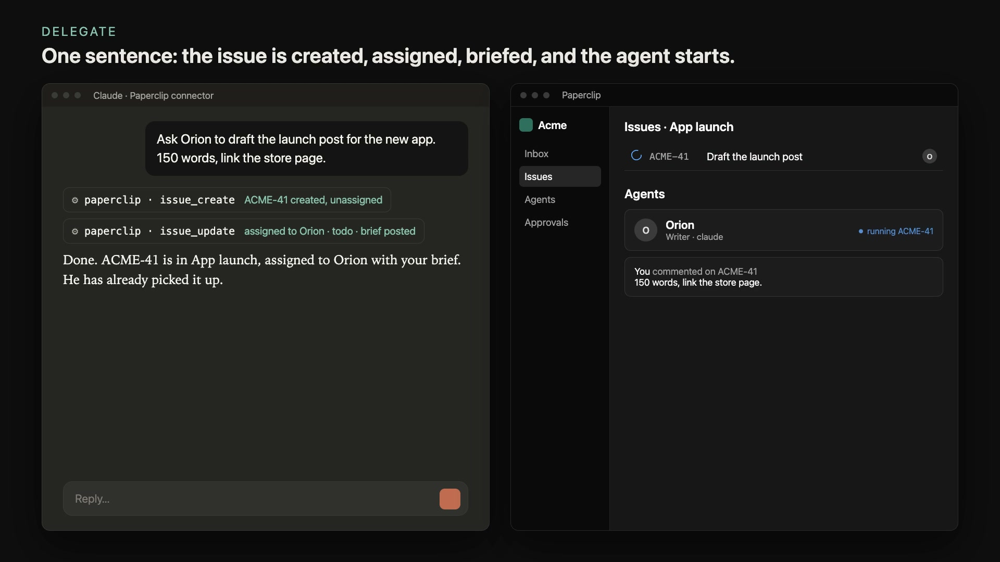

# paperclip-mcp

An MCP bridge to a [Paperclip](https://github.com/paperclipai/paperclip) instance:
its companies, its issues and whatever awaits a human decision, exposed to a remote
MCP client (claude.ai, Claude Code, any compatible client).

[](https://mickadoua.github.io/paperclip-mcp/)

A 48-second walkthrough is on the [project page](https://mickadoua.github.io/paperclip-mcp/).

## Why not the official MCP server

`@paperclipai/mcp-server` speaks stdio and exposes everything, approvals included,
plus free access to the API (`paperclipApiRequest`). This bridge exposes a closed
set of tools, each one subject to a policy.

## Policy per tool

`policy.yaml` gives each tool a mode:

| Mode | Effect |
|---|---|
| `allow` | the tool runs |
| `ask` | the server asks for confirmation through MCP elicitation; a client that cannot ask is refused |
| `deny` | the tool is not exposed (default for any tool missing from the file) |

Decision tools (`issue_update`, `approval_decision`, `interaction_respond`,
`plan_confirm`, `action_request_decision`, `agent_resume`, `agent_unblock`,
`routine_run`) only accept `ask` or `deny`: otherwise the server refuses to start.

`issue_update_without_confirmation` in `policy.yaml` lists the `issue_update`
changes that run directly: assignment (`assign: true`) and the listed statuses.
Any other change asks for confirmation. Most clients cannot ask yet, so those
changes are refused there.

The Paperclip token is a board token, with every board right: this server is the
only thing that restricts them.

## Tools

| Tool | Effect |
|---|---|
| `companies` | companies, issue prefix, id |
| `attention` | what awaits a human, across companies |
| `issues` / `issue` / `document` | issues, detail, comments, documents, pending cards |
| `agents` | agents of a company |
| `approvals` / `action_requests` | pending approvals and tool actions |
| `issue_comment` | comment on an issue |
| `issue_create` | create an issue, always unassigned, optionally in a project |
| `issue_update` | assign an issue (agent or `me`) and/or change its status, optional comment; changes outside `issue_update_without_confirmation` ask for confirmation |
| `projects` / `project_create` | list a company's projects, create one (optional GitHub repository) |
| `runs` / `run` | runs in progress across companies, an agent's last runs, a run's status, error and last agent messages |
| `issue_history` | what happened on an issue: status changes, assignments, comments, runs |
| `spend` | tokens and runs per agent over the last days (subscription runs cost 0 cents) |
| `activity` / `routines` | latest events of a company, its recurring routines |
| `agent_pause` / `agent_wake` | pause an agent (cancels its run in progress), wake it without a comment |
| `run_stop` | stop a run in progress |
| `approval_comment` | comment on an approval without deciding it |
| `agent_resume` / `agent_unblock` / `routine_run` | resume a paused agent, clear an agent's error, run a routine now; ask for confirmation |
| `approval_decision` | approve or reject an approval |
| `interaction_respond` | answer a question card |
| `plan_confirm` | accept or reject a plan |
| `action_request_decision` | authorize or decline a suspended tool action |

In Paperclip, a comment only wakes the assigned agent, and an issue assigned to a
user wakes nobody. To make an agent act, `issue_update` assigns it, sets the status
to `todo` and adds a comment saying what to do.

## Configuration

| Variable | Role |
|---|---|
| `PAPERCLIP_API_URL` | default `http://paperclip:3100` |
| `PAPERCLIP_API_KEY` | dedicated board token |
| `POLICY_FILE` | default `/app/policy.yaml` |
| `CF_ACCESS_TEAM_DOMAIN` / `CF_ACCESS_AUD` | Cloudflare Access JWT validation, required |
| `MCP_ALLOWED_HOSTS` | public hostname, otherwise the SDK answers 421 |
| `MCP_INSECURE_NO_AUTH=1` | local test without Cloudflare only |

Without `CF_ACCESS_TEAM_DOMAIN` and `CF_ACCESS_AUD`, the server refuses to start.

## Run

```sh
docker build -t paperclip-mcp .
docker run -e PAPERCLIP_API_KEY=... -e CF_ACCESS_TEAM_DOMAIN=... -e CF_ACCESS_AUD=... \
  -v ./policy.yaml:/app/policy.yaml:ro -p 9200:9200 paperclip-mcp
```

The MCP endpoint is `/mcp`, the health check `/healthz`.

## License

MIT
